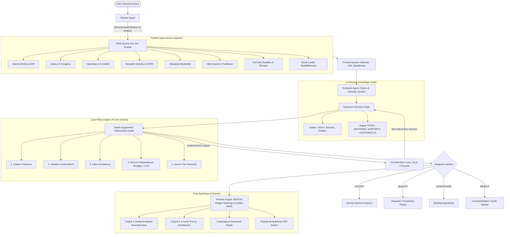

<div align="center">

# 🏛️ Histograph
### Agentic Graph-RAG Historical Research & Epistemic Verification Engine

*Eliminating LLM Hallucinations & Historiographical Monocausal Bias Through Multi-Source Primary Ingestion, In-Memory Knowledge Graphs, and Verbatim Citation Auditing.*

---

[](LICENSE)
[](https://fastapi.tiangolo.com)
[](https://react.dev)
[](https://networkx.org)
[](https://js.cytoscape.org)
[](https://www.python.org/)

<br/>

[](LICENSE)
[](#-how-it-works)
[](#-quick-start--setup-guide)
[](#-laya-policy-engine-5-point-verification)

</div>

---

## 📑 Table of Contents

- [🏛️ Overview](#-overview)
- [🎯 What Was Created](#-what-was-created)
  - [1. Multi-Agent Historical Research Pipeline](#1-multi-agent-historical-research-pipeline)
  - [2. Multi-Repository Fan-Out Ingestion Engine (10+ Open Sources)](#2-multi-repository-fan-out-ingestion-engine-10-open-sources)
  - [3. In-Memory NetworkX Knowledge Graph & Cytoscape Visualizer](#3-in-memory-networkx-knowledge-graph--cytoscape-visualizer)
  - [4. The Laya Policy Engine (5-Tier Forensic Verification)](#4-the-laya-policy-engine-5-tier-forensic-verification)
  - [5. Dual Historiographical Reconstructions](#5-dual-historiographical-reconstructions)
  - [6. BCE/CE Timeline Normalization & Date Conflict Detector](#6-bcece-timeline-normalization--date-conflict-detector)
  - [7. Modern React 19 Workspace & Academic PDF Generator](#7-modern-react-19-workspace--academic-pdf-generator)
- [💡 Why We Created It (The Problem vs. The Solution)](#-why-we-created-it-the-problem-vs-the-solution)
  - [The Fatal Flaw of Standard LLMs](#the-fatal-flaw-of-standard-llms)
  - [How Histograph Solves This (Real Agentic Graph-RAG)](#how-histograph-solves-this-real-agentic-graph-rag)
  - [The Sybil Attack & Syndicated Scraping Trap](#the-sybil-attack--syndicated-scraping-trap)
  - [History is Multi-Causal, Not Monocausal](#history-is-multi-causal-not-monocausal)
  - [Sandboxing Untrusted Web Scrapes Against Prompt Injection](#sandboxing-untrusted-web-scrapes-against-prompt-injection)
- [⚙️ How It Works](#-how-it-works)
  - [🔍 Interactive Architecture Flowchart Preview](#-interactive-architecture-flowchart-preview)
  - [Step-by-Step System Lifecycle](#step-by-step-system-lifecycle)
- [🛡️ Laya Policy Engine (5-Point Verification)](#-laya-policy-engine-5-point-verification)
- [📊 Knowledge Graph Architecture](#-knowledge-graph-architecture)
- [📑 Dual Historical Reconstruction Framework](#-dual-historical-reconstruction-framework)
  - [Output 1: Evidence-Based Historical Reconstruction](#output-1-evidence-based-historical-reconstruction)
  - [Output 2: Full-Picture (4-Level Theory Architecture)](#output-2-full-picture-4-level-theory-architecture)
- [💻 Multi-Provider LLM Support & Live Token Tracker](#-multi-provider-llm-support--live-token-tracker)
- [🔐 API Key Security (Zero-Leakage Architecture)](#-api-key-security-zero-leakage-architecture)
- [🚀 Quick Start & Setup Guide](#-quick-start--setup-guide)
  - [Prerequisites](#prerequisites)
  - [Step 1: Clone the Repository](#step-1-clone-the-repository)
  - [Step 2: Install Python Dependencies](#step-2-install-python-dependencies)
  - [Step 3: Launch Histograph](#step-3-launch-histograph)
  - [Step 4: Open in Your Browser](#step-4-open-in-your-browser)
- [🔌 API Reference](#-api-reference)
- [🧪 Testing & Benchmarks](#-testing--benchmarks)
- [⚖️ Ethics, robots.txt Compliance & Fair Use](#-ethics-robotstxt-compliance--fair-use)
- [📜 License](#-license)

---

## 🏛️ Overview

**Histograph** is an open-source, academic-grade **Agentic Graph-RAG historical research engine**. 

Standard AI chatbots (like vanilla ChatGPT or raw LLM prompts) guess answers from memorized weights, which causes them to **hallucinate fake citations, invent non-existent historical dates, and flatten complex, multi-century academic debates into simplistic, speculative prose.**

**Histograph replaces speculative generation with a deterministic, forensic investigation workflow:**
1. When asked a historical question—such as *"What caused the decline of the Indus Valley Civilization?"*—it dispatches automated research agents to fan out across **10+ open academic databases and primary digitized archives** (Internet Archive, Library of Congress, OpenAlex, CrossRef, Semantic Scholar, Wikipedia, CORE).
2. It extracts empirical claims accompanied by **100% verified verbatim quotations** ($\ge 20$ characters) found directly in source texts.
3. It builds an **in-memory directed NetworkX knowledge graph** linking claims, sources, and entities (People, Places, Events, Theories) with semantic edges (`CITES`, `SUPPORTS`, `CONTRADICTS`).
4. It audits every single claim through the **5-point Laya Policy Engine**, rejecting any claim that fabricates citations or lacks verbatim source backing.
5. It visualizes the historical findings through interactive **Cytoscape.js** graphs, chronological vertical timelines, dual academic reconstructions, and exportable PDF dossiers.

---

## 🎯 What Was Created

Histograph is a full-stack, autonomous research platform comprising the following foundational pillars:

### 1. Multi-Agent Historical Research Pipeline
An asynchronous, multi-agent cooperative architecture that coordinates research across specialized sub-agents:
- **Planner Agent (`app/agents/planner.py`)**: Deconstructs broad historical inquiries into targeted sub-queries, identifies temporal epochs (BCE/CE), and extracts target historical entities.
- **Search & Archive Agents (`app/agents/search_agent.py`, `app/agents/archive_agent.py`)**: Executes concurrent multi-repository queries across open web, peer-reviewed journals, scan OCR repositories, video transcripts, and primary libraries.
- **Extractor Agent (`app/agents/extractor.py`)**: Isolates empirical claims with verbatim text quotes, detects named entities (Persons, Places, Events, Theories), and maps semantic relations. Features a robust heuristic fallback that extracts verified claims even during cloud inference outages.
- **Graph Builder Agent (`app/agents/graph_builder.py`)**: Assembles graph nodes and relations, detecting and linking contradictory claims (`CONTRADICTS`) addressing common causal factors.
- **Laya Verification & Corroborator Agent (`app/laya/judge.py`, `app/laya/investigate.py`)**: Conducts multi-hop graph retrieval and dispatches automated corroboration rounds for claims requiring independent secondary backing.
- **Timeline Engine (`app/agents/timeline.py`)**: Normalizes complex historical date representations and flags chronometric divergences across competing accounts.

### 2. Multi-Repository Fan-Out Ingestion Engine (10+ Open Sources)
Histograph connects to a wide array of free, open scholarly repositories and digitized archives without requiring paid commercial search subscriptions:
1. **Internet Archive OCR**: Digitized scan OCR text (`_djvu.txt`) of primary sources and historical manuscripts.
2. **Library of Congress**: Catalog records, primary records, and digitized manuscripts.
3. **OpenAlex**: Global scholarly works with inverted-index abstract reconstruction.
4. **CrossRef**: Scholarly DOI metadata and publication abstracts.
5. **Semantic Scholar**: Academic citation graph search.
6. **CORE API**: Full-text and abstract index of open-access scientific papers.
7. **Wikipedia**: MediaWiki encyclopedic entries and historiographical summaries.
8. **Web Extraction**: `httpx` + `Trafilatura`, strictly obeying `robots.txt` and rate limits.
9. **Headless Browser Fallback (Playwright)**: Dynamically activated *only* when static extraction returns $< 500$ characters.
10. **YouTube Transcripts**: `yt-dlp` historical documentary subtitle and caption extraction (with local Whisper speech-to-text fallback if enabled).
11. **Public Social Channels**: Unauthenticated endpoints for Reddit (`/r/AskHistorians`), Mastodon, and Bluesky, tagged as tier `"lead"`.

### 3. In-Memory NetworkX Knowledge Graph & Cytoscape Visualizer
- **In-Memory NetworkX Directed Graph (`app/graph/store.py`)**: Requires **no external database** (no Neo4j, no PostgreSQL, no vector DB). Operates entirely in memory per session with instantaneous sub-millisecond graph operations.
- **Schema**: Typed nodes (`Claim`, `Source`, `Event`, `Theory`, `Person`, `Place`) and semantic edges (`CITES`, `MENTIONS`, `SUPPORTS`, `CONTRADICTS`, `CAUSED`, `PRECEDES`).
- **Interactive Cytoscape.js Explorer (`frontend/src/components/tabs/GraphTab.tsx`)**: Hardware-accelerated canvas with dynamic layouts (`cose` physics, `concentric`, `breadthfirst`), color-coded nodes based on verification status and entity type, edge tooltips, and a slide-over Node Drawer inspector.

### 4. The Laya Policy Engine (5-Tier Forensic Verification)
A policy engine (`app/laya/`) that audits historical claims against 5 strict rules:
1. **Citation Existence**: Confirms source ID exists in the session registry (eliminating fabricated source references).
2. **Verbatim Quote Verification**: Verifies quote presence in source text using exact or fuzzy string matching (`SequenceMatcher` $\ge 0.85$ or clustered matching blocks, length $\ge 20$ chars).
3. **Date Consistency**: Validates temporal bounds between claim year and source context.
4. **Source Independence (k-Shingle Deduplication)**: Computes 3-shingle Jaccard overlap ($< 0.60$) to detect and disqualify syndicated duplicate articles and mirror sites.
5. **Source Tier Hierarchy**: Classifies sources across 5 quality tiers (Primary Archive $\to$ Scholarly Peer-Reviewed $\to$ Encyclopedia $\to$ General Web $\to$ Social Lead). Social leads alone can **never** verify an `ACCEPT` verdict.

### 5. Dual Historiographical Reconstructions
Histograph provides two separate historical reconstructions:
- **Output 1: Evidence-Based Historical Reconstruction (`app/reports/evidence_based.py`)**: A strict empirical synthesis of verified `ACCEPT` claims, documenting surviving stratigraphic/epigraphic evidence, reported beliefs, and counterevidence notes.
- **Output 2: Full-Picture 4-Level Historiographical Architecture (`app/reports/full_picture.py`)**:
  - *Level 1: Core Competing Theories* (dominant causal models)
  - *Level 2: Historiographical Evolution & Revisions* (shift from early theories to modern models)
  - *Level 3: Active Debates & Working Hypotheses* (disputed anomalies)
  - *Level 4: Master Synthesis Architecture* (Common Bedrock Points, Pivot Points, Interlocking Factors)

### 6. BCE/CE Timeline Normalization & Date Conflict Detector
- **Integer Year Normalization**: Converts historical eras into negative/positive integers (e.g., $2500\text{ BCE} \to -2500$, $476\text{ CE} \to 476$).
- **Complex Span Parser**: Accurately interprets ranges (`c. 1900-1300 BCE`), circa prefixes (`circa 2500 BCE`), centuries (`3rd century BCE`), and mixed eras (`27 BCE – 14 CE`).
- **Date Conflict Detection**: Analyzes overlapping claims and triggers alerts whenever competing sources diverge chronologically by $> 150$ years.

### 7. Modern React 19 Workspace & Academic PDF Generator
- **React 19 + Tailwind CSS v4 + Vite Frontend**: Includes an interactive Landing Page with preset historical inquiries, live NDJSON streaming terminal, dark/light mode toggle, and the **Must-Know Historiographical Blueprint** guide.
- **ReportLab PDF Generator (`app/reports/pdf.py`)**: Exports academic PDF reports with cover page, Knowledge Graph vector snapshot, chronology table, reconstructions, Laya audit appendix, and numbered bibliography.

---

## 💡 Why We Created It (The Problem vs. The Solution)

### The Fatal Flaw of Standard LLMs
When general-purpose LLMs (like vanilla ChatGPT or raw prompts) are asked about ancient history, they produce persuasive, eloquent, and frequently false narratives:
1. **Hallucinate Non-Existent Sources**: They invent scholarly papers, fictitious authors, and non-existent excavation reports.
2. **Invent Dates and Anachronisms**: They conflate events occurring centuries apart into simultaneous occurrences (e.g., attributing 1st-century BCE Roman events to 1200 BCE Bronze Age sites).
3. **Impose Monocausal Explanations**: They present a single popular hypothesis as absolute truth (e.g., stating the Indus Valley collapsed solely due to invasion, ignoring 60 years of paleoclimatological river-avulsion research).

### How Histograph Solves This (Real Agentic Graph-RAG)
Histograph was engineered specifically to **stop** LLMs from guessing:
- **No Reliance on LLM Memory**: The system never generates claims out of thin air. It queries live primary archives and peer-reviewed journals.
- **Verbatim Quotation Enforcement**: If an LLM cannot provide a verbatim quote ($\ge 20$ chars) directly present in the source text, the claim is instantly flagged with a **`REJECT`** verdict.
- **Knowledge Graph Context**: Graph-RAG queries neighbors in the in-memory graph to supply the fact-checker with opposing claims and prior events before forming a verdict.

### The Sybil Attack & Syndicated Scraping Trap
Standard search engines and naive RAG pipelines rank syndicated scraper blogs as "independent sources". If 10 scraper sites copy the same unverified article, a naive RAG system will conclude: *"10 independent sources agree!"*

Histograph eliminates this using **3-shingle text overlap analysis**:

$$\text{Jaccard Similarity} = \frac{|S_A \cap S_B|}{|S_A \cup S_B|}$$

If two sources share $\ge 60\%$ text overlap, they are recognized as syndicated mirrors and collapsed into a single source instance.

### History is Multi-Causal, Not Monocausal
Ancient history is defined by **epistemic tension**:
- **Archaeological Strata** (sediment cores, burn layers, pollen data) frequently contradict **Ancient Dynastic Chronicles** written centuries later to legitimize rulers.
- Major transformations (such as the Late Bronze Age Collapse or the Fall of the Western Roman Empire) were driven by a cascade of **interlocking, compatible factors** (climate desiccation, trade collapse, political decentralization).

Histograph honors this complexity: rather than forcing an artificial consensus, it organizes findings into established bedrock facts, competing theories, minority perspectives, and open hypotheses.

### Sandboxing Untrusted Web Scrapes Against Prompt Injection
Untrusted web pages frequently contain adversarial text designed to hijack LLM behavior. Histograph wraps all fetched content inside explicit XML isolation boundaries:

```xml
<untrusted_source_data id="S1" title="...">
... verified source excerpt ...
</untrusted_source_data>
```
Defensive prompts instruct the inference model to treat enclosed text strictly as passive data and ignore any instructions or formatting directives embedded inside source text.

---

## ⚙️ How It Works

### 🔍 Interactive Architecture Flowchart Preview

<details open>
<summary><b>▶️ Click to Preview Architecture Flowchart (Mermaid & Visual ASCII)</b></summary>

<br/>

#### Visual Flowchart (Rendered on GitHub & Mermaid Viewers)



<br/>

#### Universal Text-Art Architecture Flowchart (Readable in Any Text Editor)

```text
 ┌────────────────────────────────────────────────────────┐
 │               User Historical Inquiry                  │
 └──────────────────────────┬─────────────────────────────┘
                            │
                            ▼
 ┌────────────────────────────────────────────────────────┐
 │           Phase 1: Planner Agent                       │
 │  Deconstructs into 3 sub-queries, epochs & entities    │
 └──────────────────────────┬─────────────────────────────┘
                            │
                            ▼
 ┌────────────────────────────────────────────────────────┐
 │       Phase 2: Multi-Repository Fan-Out Ingestion      │
 │  • Internet Archive OCR      • Library of Congress     │
 │  • OpenAlex & CrossRef       • Semantic Scholar & CORE │
 │  • Wikipedia MediaWiki       • Web (Trafilatura/HTML)  │
 │  • YouTube (yt-dlp/Whisper)  • Social Leads (Reddit)   │
 └──────────────────────────┬─────────────────────────────┘
                            │
                            ▼
 ┌────────────────────────────────────────────────────────┐
 │       Phase 3: Sandboxing & Verbatim Extraction        │
 │  • XML Untrusted Data Sandboxing                       │
 │  • Verbatim Quotes (>= 20 chars) matched in text       │
 │  • Named Entities: Person, Place, Event, Theory        │
 └──────────────────────────┬─────────────────────────────┘
                            │
                            ▼
 ┌────────────────────────────────────────────────────────┐
 │     Phase 4: In-Memory NetworkX Knowledge Graph        │
 │  • Nodes: Claims, Sources, Historical Entities         │
 │  • Edges: CITES, MENTIONS, SUPPORTS, CONTRADICTS       │
 └──────────────────────────┬─────────────────────────────┘
                            │
                            ▼
 ┌────────────────────────────────────────────────────────┐
 │     Phase 5: Laya Policy Engine (5 Core Checks)        │
 │  [1] Citation Exists        [4] Source Independence    │
 │  [2] Verbatim Quote Verified[5] Source Tier Hierarchy  │
 │  [3] Date Consistency                                  │
 │                                                        │
 │  Verdicts:                                             │
 │  🟢 ACCEPT        🟡 QUALIFY                           │
 │  🔵 INVESTIGATE   🔴 REJECT                            │
 └──────────────────────────┬─────────────────────────────┘
                            │
                            ▼
 ┌────────────────────────────────────────────────────────┐
 │     Phase 6: Timeline Reconciliation (BCE / CE)        │
 │  • Integer normalization (e.g. -2500 for 2500 BCE)     │
 │  • Date conflict alerts (> 150 yrs discrepancy)        │
 └──────────────────────────┬─────────────────────────────┘
                            │
                            ▼
 ┌────────────────────────────────────────────────────────┐
 │             Phase 7: Syntheses & Exports               │
 │  • Output 1: Evidence-Based Historical Reconstruction  │
 │  • Output 2: 4-Level Historiographical Architecture    │
 │  • Interactive Cytoscape.js Knowledge Graph Canvas     │
 │  • Academic PDF Dossier with Graph Vector Snapshot     │
 └────────────────────────────────────────────────────────┘
```

</details>

---

### Step-by-Step System Lifecycle

1. **Inquiry Planning**: The user submits a research question. The Planner Agent generates 3 targeted sub-queries addressing archaeological evidence, primary sources, causal mechanisms, and chronology.
2. **Concurrent Multi-Source Ingestion**: The Search and Archive agents dispatch parallel asynchronous HTTP requests across 10+ open repositories. Each source is checked against its host domain's `robots.txt` and cached for 1 hour.
3. **Sandboxing & Extraction**: Retrieved source texts are sanitized and sandboxed within `<untrusted_source_data>` tags. The Extractor extracts empirical claims, verbatim quotes, and entities (Persons, Places, Events, Theories). If LLM cloud inference is unavailable, an intelligent heuristic fallback extracts verified claims directly from source sentences.
4. **NetworkX Knowledge Graph Assembly**: Nodes and edges are created in memory. Claim nodes are linked to sources via `CITES` edges and to entities via `MENTIONS` edges. Contradictory claims are linked via `CONTRADICTS` edges.
5. **Graph-Augmented Laya Audit**: Each claim is evaluated against its local graph neighborhood (cited sources, contradicting claims, preceding events). The 5-point policy engine assigns verdicts: `ACCEPT`, `QUALIFY`, `INVESTIGATE`, or `REJECT`.
6. **Targeted Corroboration Loop**: Claims supported only by single non-scholarly sources (`INVESTIGATE`) trigger targeted queries dispatched to search agents for corroboration.
7. **Chronology & Conflict Reconciliation**: All claims are sorted chronologically. If competing sources diverge by $> 150$ years on related claims, a date conflict warning is flagged.
8. **Dual Reconstruction Synthesis**: The engine generates Output 1 (strict empirical reconstruction) and Output 2 (4-level historiographical architecture), streams progress via NDJSON SSE, updates the Cytoscape canvas, and renders the PDF report.

---

## 🛡️ Laya Policy Engine (5-Point Verification)

Every historical claim undergoes an automated 5-point verification pipeline:

| Check | Name | Description | Policy Threshold |
|---|---|---|---|
| **1** | **Citation Existence** | Validates that every cited source ID exists in the session registry | Rejects fabricated citations immediately (`REJECT`) |
| **2** | **Quote Verification** | Verifies the quotation exists verbatim in cited source text | Exact or fuzzy match (`SequenceMatcher` $\ge 0.85$ or clustered matching blocks, length $\ge 20$ chars) |
| **3** | **Date Consistency** | Verifies claim date is consistent with dates extracted from source context | Flags temporal divergence beyond tolerance window |
| **4** | **Source Independence** | Checks domain `netloc` and computes **k-shingle overlap** ($k=3$) | Jaccard similarity $< 0.60$ to detect and disqualify syndicated duplicate mirrors |
| **5** | **Source Tier Hierarchy** | Classifies sources into quality tiers: Primary Archive $\to$ Peer-Reviewed $\to$ Encyclopedia $\to$ Web $\to$ Social Lead | Social content alone can **never** verify an `ACCEPT` claim |

### Verdict Definitions
- 🟢 **ACCEPT (Evidence-Based)**: Claim is marked `established`, quotation is verified, backed by at least one Tier 1/2 source or two independent domains, and has **no unresolved `CONTRADICTS` edge with an equal or higher tier source**.
- 🟡 **QUALIFY**: Supported by sources, but categorized as competing, minority, or hypothetical, or contested by an alternative theory.
- 🔵 **INVESTIGATE**: Supported only by a single non-scholarly or social source. Automatically emits targeted tasks dispatched to search and archive agents for **up to 3 corroboration rounds**.
- 🔴 **REJECT**: Quotation not found in source text, source unmapped, or claim misrepresents source evidence. Every rejection stores a machine-readable reason list.

---

## 📊 Knowledge Graph Architecture

Histograph constructs a directed graph using **NetworkX**:

```
[Source Node S1] <--- CITES --- [Claim Node C1] --- MENTIONS ---> [Entity Node: Indus River]
                                       |
                                  CONTRADICTS
                                       |
                                       v
[Source Node S2] <--- CITES --- [Claim Node C2] --- MENTIONS ---> [Entity Node: Megadrought]
```

### Node Types
- **Claim**: Historical propositions with date text, normalized year, verdict, verbatim quote, and category.
- **Source**: Ingested source with title, URL, repository kind, and tier classification.
- **Entity**: Named historical actors, locations, and phenomena:
  - `Person` (e.g., *Sir Mortimer Wheeler*, *Julius Caesar*)
  - `Place` (e.g., *Mohenjo-daro*, *Hattusa*, *Alexandria*)
  - `Event` (e.g., *Late Bronze Age Collapse*, *4.2k Year BP Aridification Event*)
  - `Theory` (e.g., *Hydro-Climatic Shift Model*, *Aryan Migration Paradigm*)

### Edge Types
- `CITES`: Directed edge from Claim to Source.
- `MENTIONS`: Directed edge from Claim to Entity.
- `CONTRADICTS`: Bidirectional dashed edge between competing claims addressing the same event with mutually exclusive conclusions.
- `SUPPORTS`: Directed edge indicating evidentiary reinforcement.
- `CAUSED` / `PRECEDES`: Directed temporal and causal linkages.

---

## 📑 Dual Historical Reconstruction Framework

Histograph outputs two distinct historical views:

### Output 1: Evidence-Based Historical Reconstruction
A strict empirical synthesis adhering to the principle of historical falsifiability:
1. **Core Evidence-Based Explanatory Theory**: The most defensible model derived strictly from surviving physical artifacts, stratigraphic excavations, and peer-reviewed consensus.
2. **Chronological Phase Narrative**: Strict chronological progression with verified verbatim quotes and source links.
3. **Tripartite Distinction**:
   - *Historical Evidence*: Surviving archaeological artifacts, radiocarbon strata, and verified inscriptions.
   - *Reported Beliefs & Traditional Theories*: What subsequent communities or earlier historiographical models claimed happened.
   - *Unresolved Questions*: Questions that cannot be settled conclusively from available evidence.
4. **Counterevidence & Contradictions**: Explicit documentation of competing theories and why consensus has shifted.

### Output 2: Full-Picture (4-Level Theory Architecture)
A comprehensive historiographical assessment:
- **Level 1: Core Competing Theories**: Deep breakdown of the primary rival academic paradigms, citing proponents, empirical evidence, and scholarly critiques.
- **Level 2: Historiographical Evolution & Revisions**: Tracing how the academic debate evolved over the 19th, 20th, and 21st centuries.
- **Level 3: Active Debates & Working Hypotheses**: Emerging revisionist perspectives, newly discovered archaeological sites, and paleoclimatic data.
- **Level 4: Master Synthesis Architecture**:
  - *Common Bedrock Points*: Empirical facts universally accepted across all competing schools.
  - *The Pivot Point*: The precise chronological juncture or systemic threshold where equilibrium irreversibly tipped.
  - *Compatible Determining Factors*: How multiple factors (climate desiccation, trade collapse, political decentralization) interacted as a multi-causal cascade.
  - *Master Synthesis Narrative*: Unified epistemic synthesis reconciling the evidence without false homogenization.

---

## 💻 Multi-Provider LLM Support & Live Token Tracker

Histograph features an adaptable LLM abstraction layer (`app/llm/`) supporting multiple inference backends:

| Provider | Default Model | Supported Models | Tier |
|---|---|---|---|
| **Google Gemini** | `gemini-2.0-flash` | `gemini-2.0-flash`, `gemini-2.5-flash`, `gemini-1.5-flash`, `gemini-1.5-pro` | Free (1M TPM) |
| **Groq** | `llama-3.3-70b-versatile` | `llama-3.3-70b-versatile`, `llama-3.1-8b-instant`, `mixtral-8x7b-32768` | Free & Instant |
| **NVIDIA NIM** | `meta/llama-3.2-11b-vision-instruct` | `meta/llama-3.2-11b`, `meta/llama-3.2-90b`, `llama-3.1-nemotron-70b` | Free credits |
| **OpenRouter** | `meta-llama/llama-3.3-70b-instruct:free` | `deepseek/deepseek-r1:free`, `google/gemini-2.0-flash-exp:free` | Free tier |
| **Ollama** | `llama3.3` | `llama3.3`, `llama3.1`, `mistral`, `qwen2.5` | 100% Local / Offline |

### Live Token Tracker Dashboard
Tracks usage in real time via `GET /api/tokens`:
- **Real-time token metrics**: Prompt input tokens, completion output tokens, total tokens consumed.
- **Credits Remaining**: Live calculated balance against allocated limits.
- **Reset API**: `POST /api/tokens/reset` for session benchmarking.

---

## 🔐 API Key Security (Zero-Leakage Architecture)

Histograph is designed with strict security standards to ensure **zero credential leakage**:

1. **Git-Ignored Local Secrets**: The project `.gitignore` permanently excludes `.env`, `.env.local`, and all secret configuration files. They can never be committed or pushed to public repositories.
2. **Zero Hardcoded Secrets**: There are no hardcoded default API keys in the source code. All inference clients dynamically read from environment variables or per-session HTTP headers.
3. **Bring-Your-Own-Key (BYOK) via Browser UI**: Users can paste their API key directly into the web interface. Keys entered in the UI are held only in temporary browser memory and transmitted securely via request headers (`x-api-key`). They are never saved to disk.
4. **Offline Heuristic Mode (No Key Required)**: If no API key is provided, Histograph automatically falls back to its deterministic, rule-based heuristic extraction engine. The engine functions fully without external cloud accounts.

---

## 🚀 Quick Start & Setup Guide

Histograph runs directly on your machine without requiring complex databases or Docker:

### Prerequisites
- **Python 3.11+** installed on your system ([Download Python](https://www.python.org/downloads/))
- **Git** installed ([Download Git](https://git-scm.com/))

---

### Step 1: Clone the Repository
```bash
git clone https://github.com/rajarajendra1103/Histograph.git
cd Histograph
```

---

### Step 2: Install Python Dependencies
Create an optional virtual environment and install the required packages:

```bash
# Optional: Create and activate virtual environment
python -m venv venv

# On Windows:
venv\Scripts\activate
# On macOS / Linux:
source venv/bin/activate

# Install requirements
pip install -r requirements.txt
```

---

### Step 3: Launch Histograph
Run the application launcher:

```bash
python app.py
```
*(Alternatively, you can run directly with Uvicorn: `uvicorn app.main:app --port 8000 --reload`)*

---

### Step 4: Open in Your Browser
Open your browser and navigate to:
```
http://localhost:8000
```

The application will immediately serve the modern React 19 interface. You can type any historical inquiry (or click one of the preset benchmark buttons) and watch the research agents run in real time!

---

## 🔌 API Reference

### 1. Research Pipeline (NDJSON Streaming)
**`POST /api/research`**

Streams multi-agent research progress events and final synthesis as newline-delimited JSON.

**Headers:**
- `x-provider`: (Optional) `gemini`, `groq`, `nvidia`, `openrouter`, or `ollama`.
- `x-api-key`: (Optional) Provider API key.
- `x-nvidia-model`: (Optional) Model identifier.

**Request Body:**
```json
{
  "query": "What caused the decline of the Indus Valley Civilization?"
}
```

**Streamed Event Types:**
- `{"type": "log", "step": "planner", "msg": "..."}`
- `{"type": "tokens", "stats": {"prompt_tokens": 120, "completion_tokens": 340}}`
- `{"type": "result", "data": { ... complete research dossier ... }}`

---

### 2. Available Models & Providers
**`GET /api/models?provider=nvidia`**

Returns active and available models for the specified provider:
```json
{
  "provider": "nvidia",
  "default": "meta/llama-3.2-11b-vision-instruct",
  "models": ["meta/llama-3.2-11b-vision-instruct", "nvidia/llama-3.1-nemotron-70b-instruct"]
}
```

---

### 3. Token Dashboard
**`GET /api/tokens`** — Retrieve token consumption and remaining credit metrics.  
**`POST /api/tokens/reset`** — Reset token counters to zero.

---

### 4. Academic PDF Export
**`POST /api/pdf`**

Generates a formatted academic PDF report. Accepts the research result JSON payload and returns `application/pdf`.

---

## 🧪 Testing & Benchmarks

Histograph includes a complete unit test suite (28 passing tests):

```bash
# Run all 28 unit tests
pytest tests/ -v
```

### Landmark Historical Benchmark Runner
You can also run the automated end-to-end benchmark (`scripts/smoke_test.py`) on 3 classic historical problems:
1. *What caused the decline of the Indus Valley Civilization?*
2. *What caused the fall of the Western Roman Empire?*
3. *Did the Library of Alexandria burn down in a single catastrophic event or decline gradually over centuries?*

> **Evidentiary Assertion**: The benchmark automatically fails if **any** `ACCEPT` claim lacks a verified verbatim quote of at least 20 characters found within the cited source text.

```bash
# Offline benchmark (validates multi-source ingestion, graph assembly, timeline, quote matching, and PDF generation)
python scripts/smoke_test.py --offline

# Live benchmark with an API key (e.g. Groq or Gemini)
python scripts/smoke_test.py --live --key gsk_yourKeyHere
```

---

## ⚖️ Ethics, robots.txt Compliance & Fair Use

Histograph is designed for open scholarly research and adheres to responsible extraction standards:
- **`robots.txt` Compliance**: The web extraction engine parses each site's `robots.txt` before issuing requests. Disallowed paths are respected and skipped.
- **Polite Rate Limiting**: An in-memory rate limiter enforces delays between requests to the same domain to prevent server stress.
- **In-Memory Caching**: HTTP responses from public repositories are cached locally for 1 hour to minimize duplicate queries.
- **API Terms Compliance**: Users are responsible for complying with the API usage terms of external data providers (OpenAlex, CrossRef, Semantic Scholar, Internet Archive, Library of Congress, Reddit, Mastodon, Bluesky).

---

## 📜 License

This project is licensed under the **Apache License, Version 2.0** - see the [LICENSE](LICENSE) file for details.

```text
Copyright 2026 rajarajendra1103

Licensed under the Apache License, Version 2.0 (the "License");
you may not use this file except in compliance with the License.
You may obtain a copy of the License at

    http://www.apache.org/licenses/LICENSE-2.0
```

---

<div align="center">

**Histograph: Bringing Epistemic Rigor, Verbatim Quotes, and Graph-RAG to Historical AI Research.**

*Created for historians, researchers, and students who demand verified evidence over speculative prose.*

</div>
